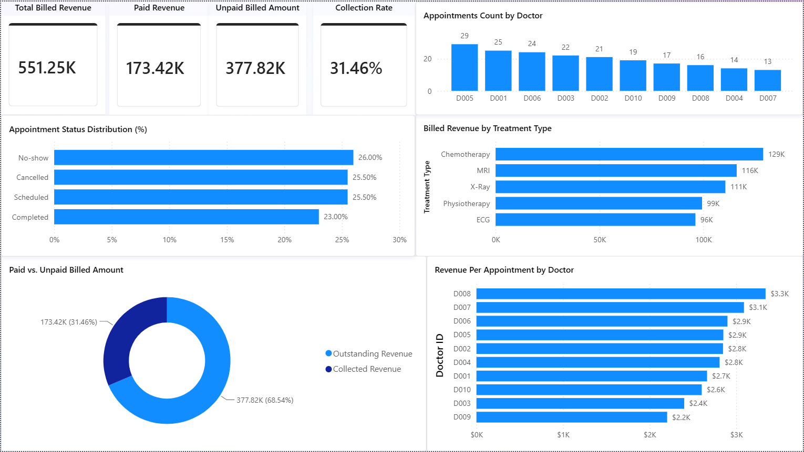
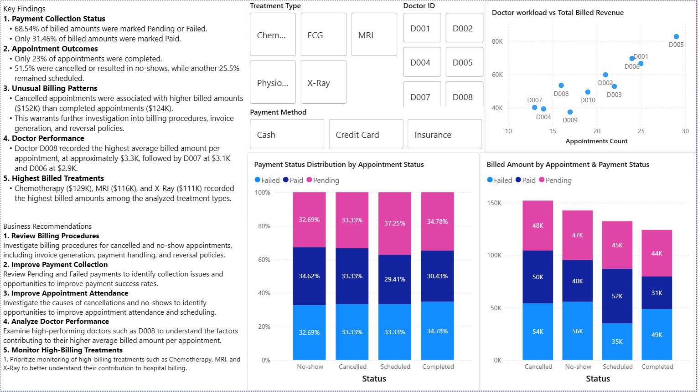

# Hospital Revenue, Operations & Billing Analysis

End-to-end healthcare analytics project focused on hospital financial performance, operational efficiency, billing behavior, and doctor performance.

This project simulates a real-world data analyst workflow by working with raw hospital datasets, performing SQL analysis, Python data cleaning and exploratory analysis, investigating unusual billing patterns, and building interactive Power BI dashboards.

---

## Project Objective

The goal of this project was to answer business-critical hospital management questions such as:

- How much of the total billed amount has actually been collected?
- Which treatment types have the highest billed amounts?
- Which doctors have the highest average billed amount per appointment?
- What proportion of appointments are completed, cancelled, no-show, or scheduled?
- Are there unusual patterns in the hospital billing process?
- How are payment statuses distributed across different appointment statuses?

---

## Tools Used

- **SQL (MySQL)** → Database creation, joins, aggregations, and business queries
- **Python** → Data cleaning and exploratory data analysis
- **Pandas** → Data manipulation and merging
- **Matplotlib / Seaborn** → Data visualization and exploratory analysis
- **Power BI** → Interactive dashboards, DAX measures, and business insights

---

## Dataset

The dataset contains 5 CSV files representing hospital operations:

- Patients
- Doctors
- Appointments
- Treatments
- Billing

**Source:** Public healthcare dataset obtained from Kaggle.

---

## Project Workflow

### 1. SQL Database Design & Analysis

Created a relational database and imported all five CSV files.

Created five tables:

- patients
- doctors
- appointments
- treatments
- billing

Performed SQL analysis using joins, aggregations, and business queries.

Example business questions:

- Which doctors handle the most appointments?
- Which treatment types have the highest billed amounts?
- Which patients have bills that are not marked as paid?
- Which specializations have the highest billed amounts?
- Which patients have the highest total billed amounts?

---

### 2. Python Data Cleaning & Analysis

Performed data cleaning and datatype standardization.

Tasks:

- Converted date columns to datetime
- Standardized phone numbers as text
- Created a patient age column
- Merged multiple tables for analysis
- Performed exploratory data analysis (EDA)
- Created visualizations to identify trends and unusual patterns

Libraries used:

```python
import pandas as pd
import matplotlib.pyplot as plt
import seaborn as sns
```

---

### 3. Billing Anomaly Investigation

During the analysis, an unusual billing pattern was identified involving patient **P012**, who had the highest total billed amount in the dataset.

Further examination revealed:

- Most of P012's appointments were Cancelled or No-show.
- Billing records were still associated with these appointments.
- Billed amounts were recorded even though the appointments were not completed.

### Billed Amount by Appointment Status

| Appointment Status | Billed Amount |
| ------------------ | ------------: |
| Cancelled          |      $152,044 |
| No-show            |      $142,677 |
| Scheduled          |      $132,426 |
| Completed          |      $124,100 |

**Key observation:**

Cancelled appointments were associated with higher billed amounts ($152,044) than completed appointments ($124,100).

This raised questions about the hospital's billing procedures.

### Possible Explanations

- Invoices may be generated before services are delivered.
- Charges may not be reversed after cancellations or no-shows.
- Billing procedures may not adequately distinguish between completed and uncompleted appointments.

### Potential Business Risks

- Inaccurate financial reporting
- Patient billing disputes
- Poor patient experience
- Incorrect outstanding balance reporting

**Note:** The available dataset identifies unusual billing patterns but does not contain sufficient transaction, refund, or reversal information to confirm a billing-system flaw. Further investigation would be required.

---

## Key Insights

### 1. Payment Collection Status

- Total Billed Amount: Approximately $551,249
- Paid Amount: Approximately $173,424
- Amount Not Marked as Paid: Approximately $377,824
- Collection Rate: 31.46%

Only **31.46% of billed amounts were marked as Paid**, while the remaining **68.54% were marked as Pending or Failed**.

This indicates a significant payment collection concern that warrants further investigation.

*Note: Pending and Failed payments are not necessarily recoverable outstanding debt.*

---

### 2. Appointment Outcomes

Appointment distribution:

| Appointment Status | Percentage |
| ------------------ | ---------: |
| Completed          |        23% |
| No-show            |        26% |
| Cancelled          |      25.5% |
| Scheduled          |      25.5% |

Only **23% of appointments were completed**.

A further **51.5% were cancelled or resulted in no-shows**, while another **25.5% remained scheduled**.

This highlights opportunities to investigate appointment attendance, cancellations, and scheduling processes.

---

### 3. Payment Status by Appointment Status

Analyzed the distribution of Paid, Pending, and Failed bills across appointment statuses.

Key observations:

- Cancelled appointments had an equal distribution of Pending, Paid, and Failed bills, with 17 bills in each category (33.33% each).
- No-show appointments had 17 Failed, 18 Paid, and 17 Pending bills.
- Completed appointments had 14 Paid bills out of 46 (30.43%).

The equal payment-status distribution for cancelled appointments is an unusual pattern worth investigating, although it does not establish whether the distribution was intentional.

---

### 4. Highest Billed Treatments

The treatments with the highest billed amounts were:

| Treatment    | Billed Amount |
| ------------ | ------------: |
| Chemotherapy |         $129K |
| MRI          |         $116K |
| X-Ray        |         $111K |

These treatments recorded the highest billed amounts among the analyzed treatment types.

---

### 5. Doctor Performance

Doctors with the highest average billed amount per appointment:

| Doctor | Billed Amount per Appointment |
| ------ | ----------------------------: |
| D008   |                        $3,339 |
| D007   |                        $3,089 |
| D006   |                        $2,899 |

Doctor D008 recorded the highest average billed amount per appointment.

This metric reflects average billed value, not doctor profitability or operational efficiency.

---

## Power BI Dashboard

The Power BI report contains two interactive dashboard pages.

### Dashboard 1: Hospital Overview

Main dashboard showing:

- Total Billed Revenue
- Paid Revenue
- Unpaid Billed Amount
- Collection Rate
- Appointment Status Distribution
- Appointments Count by Doctor
- Billed Revenue by Treatment Type
- Paid vs. Unpaid Billed Amount
- Revenue per Appointment by Doctor



### Dashboard 2: Insights & Slicers

Secondary dashboard page focused on deeper analysis and billing behavior.

Includes:

- Key business findings and recommendations
- Doctor Workload vs. Total Billed Revenue scatter plot
- Payment Status Distribution by Appointment Status
- Billed Amount by Appointment & Payment Status
- Interactive slicers for:
  - Doctor ID
  - Treatment Type
  - Payment Method
    
  

The slicers are synchronized across both dashboard pages, allowing users to explore the data interactively.

---

## Files Included

Project files:

- `hospital_analysis.sql` → SQL queries and database analysis
- `hospital_analysis.ipynb` → Python data cleaning and exploratory analysis
- `hospital_dashboard.pbix` → Interactive Power BI report
- `dashboard.png` → Hospital Overview dashboard screenshot
- `insights.png` → Insights & Slicers dashboard screenshot

Dataset files:

- `patients.csv`
- `doctors.csv`
- `appointments.csv`
- `treatments.csv`
- `billing.csv`

---

## Business Recommendations

### 1. Review Billing Procedures

Investigate billing procedures for cancelled and no-show appointments, including invoice generation, payment handling, and reversal policies.

### 2. Improve Payment Collection

Review Pending and Failed payments to identify collection issues and opportunities to improve payment success rates.

### 3. Improve Appointment Attendance

Investigate the causes of cancellations and no-shows to identify opportunities to improve appointment attendance and scheduling.

### 4. Analyze Doctor Performance

Examine high-performing doctors such as D008 to understand the factors contributing to their higher average billed amount per appointment.

### 5. Monitor High-Billing Treatments

Prioritize monitoring of high-billing treatments such as Chemotherapy, MRI, and X-Ray to better understand their contribution to hospital billing.

---

## Project Type

End-to-End Data Analyst Portfolio Project

**SQL + Python + Pandas + Power BI + Business Intelligence + Data Visualization**

---

## Repository Structure

```text
hospital-revenue-operations-analysis/
│
├── Data/
│   ├── patients.csv
│   ├── doctors.csv
│   ├── appointments.csv
│   ├── treatments.csv
│   └── billing.csv
│
├── SQL/
│   └── hospital_analysis.sql
│
├── Python/
│   └── hospital_analysis.ipynb
│
├── PowerBI/
│   └── hospital_dashboard.pbix
│
├── dashboard.png
├── insights.png
│
└── README.md
```

